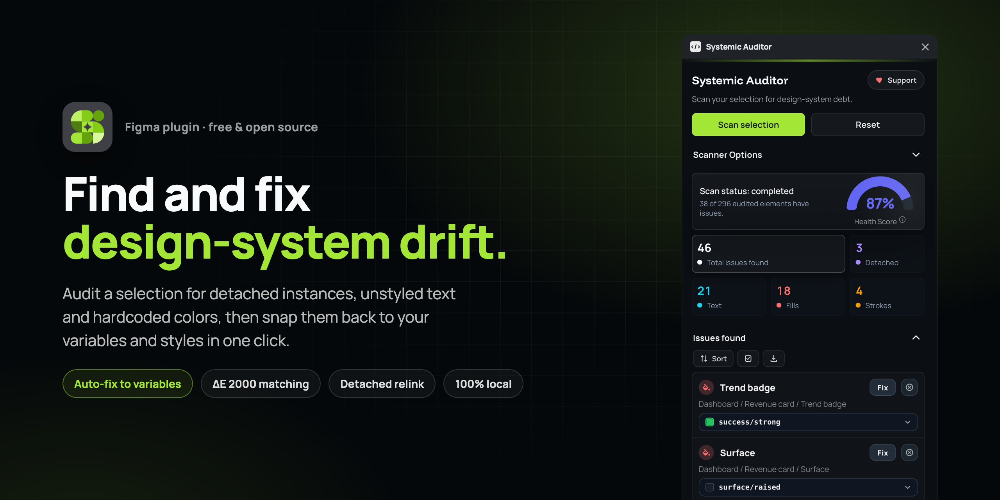
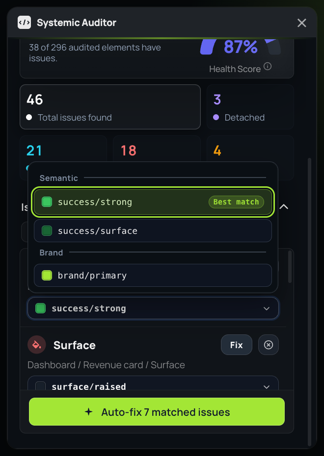
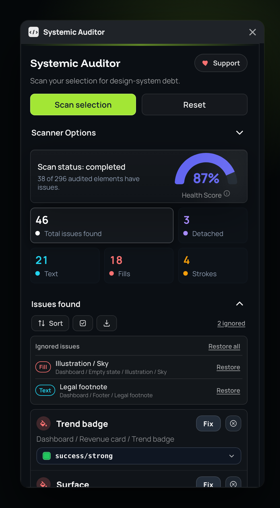

<div align="center">


# Systemic Auditor

**Find and fix design-system drift in Figma.**
Detached instances, unstyled text and hardcoded colors, snapped back to your variables and styles in one click.

[](https://www.figma.com/community/plugin/1588257751230049347)
[](LICENSE)
[](https://ko-fi.com/alfremiranda)



</div>

## Why

As teams scale, consistency drops. Designers detach instances for speed, and "rogue" hex codes and one-off text settings slip into production files. Most linters stop at pointing these out. Systemic Auditor finds them, shows you the exact variable or style each one should use, and fixes them, one at a time or all at once.

It's **free, open source and runs 100% locally**: no account, no license key, and no network requests beyond loading its font.

## What it does

<table>
<tr>
<td width="50%" valign="top">

**🔍 Find**
- **Deep scan** of a selection (optionally including children) for hardcoded fills and strokes, text without a text style, and detached instances.
- A **health score** (0–100%) and per-type counts that double as filters.
- **One-click zoom** from any issue to its layer, or **select all** issues on the canvas.

**🪄 Fix**
- Every row shows its **best match** before you apply it, and you can pick a different candidate from the menu.
- **Auto-fix all** applies every confident match in one pass, and the button tells you exactly how many issues that is.
- **Detached relink** recreates the instance from its main component and replays your overrides: text, layout, fills, strokes, effects, corner radius, visibility, opacity and nested component swaps.

**🧭 Stay in control**
- An **ignore list** for intentional exceptions, stored on the layer so it travels with the file. Restore one issue or all of them anytime.
- **Sort, filter and export** any scan to CSV for reviews or handoff.

</td>
<td width="50%" valign="top">


<br/><br/>


</td>
</tr>
</table>

## How the matching works

The interesting part of the plugin is deciding *which* variable or style a hardcoded value should become.

- **Perceptual color distance.** Colors are compared in CIELAB with **CIEDE2000** (ΔE 2000), not RGB distance, so a match means "looks the same", not "has similar numbers". Candidates within ΔE 5 are offered; only those under **ΔE 2** (below the threshold most people can notice) can be recommended or auto-applied.
- **Modes and aliases are resolved for the layer.** A variable's value is read for the mode the layer actually uses (explicit or inherited Light/Dark, brand themes), following alias chains with cycle protection, so `button/bg → brand/primary → lime/400` resolves to the color that layer would really render.
- **Local and team-library variables.** Enabled library collections are imported once and cached; a scan's candidate lookups share a single fetch of local variables instead of hitting the Figma API per issue.
- **Ranking, not just distance.** Ties are broken by intent: semantic collections over primitive palettes, aliases over raw values, local over remote, names that fit the layer's role (strokes prefer `border/*`, text `text/*` or `fg/*`, vectors `icon/*`, frames `bg/*` or `surface/*`) and naming intent (`primary` over `inverse`/`disabled`). Variable scopes are respected, and strokes are never offered background-only variables.
- **Text styles** are recommended only on an exact match of size, line height and letter spacing; close matches are offered for a human to choose.
- **Large files stay responsive.** Candidates are fetched lazily, visible rows first, three at a time, so a 500-issue scan is usable immediately and keeps filling in.

## Install

- **From Figma:** [Systemic Auditor on the Figma Community](https://www.figma.com/community/plugin/1588257751230049347) → *Open in…* → Figma.
- **From source:** clone this repo, run `npm install && npm run build`, then in Figma desktop choose **Plugins → Development → Import plugin from manifest…** and pick `manifest.json`.

## Development

```bash
npm install
npm run build      # compile code.ts -> code.js (code.js is committed; manifest.json points at it)
npm run watch      # rebuild on change
npm run typecheck  # tsc --noEmit
npm run lint
npm test           # Node tests for code.js against a stubbed figma API
```

The plugin is two files that talk over `postMessage`: **`code.ts`** runs in Figma's sandbox (scene graph, no DOM) and **`ui.html`** is the whole interface (markup, CSS and JS in one file, no build step). [CLAUDE.md](CLAUDE.md) documents the architecture, the message protocol, domain rules and known issues in detail.

### Tests

- `npm test` runs `tests/backend.test.js` and `tests/cache.test.js`, which load the compiled `code.js` into a Node `vm` with a fake `figma` object. Run `npm run build` first.
- `tests/ui-harness.html` drives `ui.html` in an iframe with a fake backend. Serve the repo root (`python3 -m http.server 8790`), open `http://localhost:8790/tests/ui-harness.html`, then run `await load(); await T.all();` in the console and inspect `results`. The harness stubs `requestAnimationFrame`, CSS motion and the export download, so it behaves the same in a hidden tab and never saves a file.

### Notes

- `documentAccess` is `dynamic-page`, so only the async Plugin APIs work (`getNodeByIdAsync`, `setFillStyleIdAsync`, …); the sync variants throw.
- Network access is limited to Google Fonts (`manifest.json` → `networkAccess.allowedDomains`).
- The header's "Support" button opens `SUPPORT_URL` (top of the `<script>` in `ui.html`); set it to an empty string to hide it.

## Support

Systemic Auditor is free and stays that way. If it saves you time, you can [buy me a coffee on Ko-fi](https://ko-fi.com/alfremiranda). Bug reports and ideas are welcome in [Issues](https://github.com/alfremiranda/systemic-auditor/issues).

Made by [Alfredo Miranda](https://alfremiranda.com), product designer in Barranquilla.

## License

[MIT](LICENSE)
